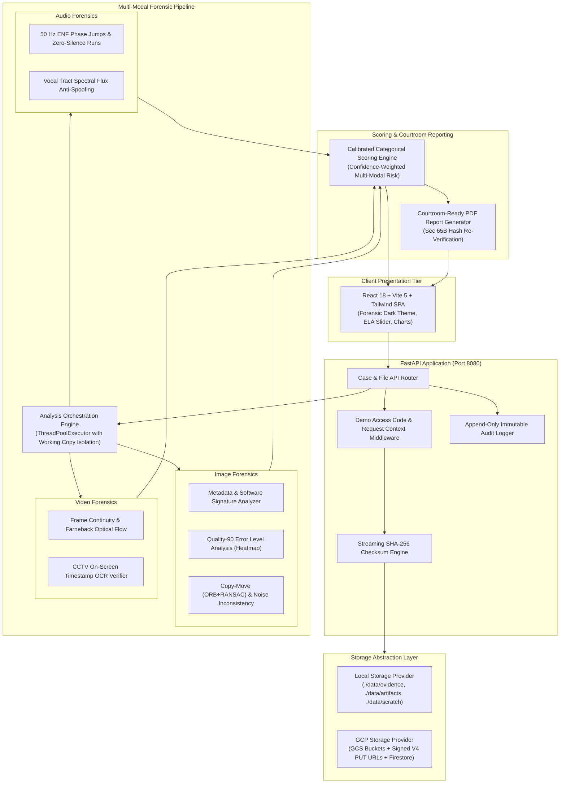

# FORGE: System Architecture & Technical Specifications
**Cyber Hackathon 2026** • C-DAC Patna / CCSU Bihar Police • Problem Statement PS-05 (Digital Forensics)

---

## 1. Architectural Philosophy & Non-Negotiable Tenets

FORGE is engineered around three foundational digital forensics principles:

1. **Zero-Fabrication Integrity Policy**:
   - Every risk score, anomaly bounding box, phase jump, and confidence percentage derives from strict mathematical and signal processing algorithms.
   - If a specific analysis cannot execute (e.g., audio file has no EXIF data, video has no audio track, or OCR engine lacks on-screen text), the system explicitly reports `NOT_APPLICABLE` or `INCONCLUSIVE` with plain-English technical explanations. It never fabricates proxy scores.

2. **Strict Read-Only Chain of Custody (ISO/IEC 27037:2012)**:
   - Original digital evidence files uploaded by investigators are immediately hashed via streaming SHA-256 and stored with POSIX read-only attributes (`chmod 444`).
   - Forensic analysis modules *never* touch the original file. Instead, the storage provider provisions an isolated, transient working copy in scratch space.
   - Every access, upload, analysis run, and report generation is cryptographically bound into an append-only SQLite or Cloud Firestore audit log.

3. **High-Performance CPU Execution (Edge & Cloud Run Compatible)**:
   - Deep learning inference on heavy GPUs is inaccessible to many local police stations and incurs high cold-start latencies.
   - FORGE utilizes classical computer vision (ORB/RANSAC, DCT frequency quantization, optical flow) and scientific signal processing (Hilbert phase extraction, Second-Order Sections filters, perceptual hashing) to operate in $< 1.5$ seconds on standard 2-vCPU / 4GB Cloud Run instances.

---

## 2. End-to-End System Architecture

---

## 3. Forensic Engine Specifications & Mathematics

### 3.1 Image Forensics

#### A. Metadata & Software Signature (`image_metadata.py`)
- **EXIF Extraction**: Extracts raw EXIF, IPTC, and XMP tags using `Pillow` and `piexif` with fallback to `exiftool`.
- **Software Signature Detection**: Checks tags `0x0131` (Software), `0x010E` (ImageDescription), and `0x013B` (Artist) against an exact regex pattern:
  $$\text{Regex} = \text{Photoshop} \mid \text{GIMP} \mid \text{Snapseed} \mid \text{Lightroom} \mid \text{Canva} \mid \text{PicsArt} \mid \text{InShot}$$
- **Temporal Future Anomaly**: Compares `DateTimeDigitized` and `DateTimeOriginal` against $T_{\text{current}} + 120\text{ sec}$.
- **Embedded Thumbnail Discrepancy**: Extracts embedded EXIF thumbnail, computes 64-bit dHash (difference hash) of thumbnail and primary image. If Hamming distance $D_H > 15$, flags crop/substitution forgery.

#### B. Error Level Analysis (`image_ela.py`)
- Re-saves working copy JPEG at calibrated Quality $Q = 90$.
- Computes absolute difference:
  $$\Delta(x, y) = |I_{\text{original}}(x, y) - I_{Q90}(x, y)|$$
- Maps error levels to color heatmap using high-gain scale ($\times 15$) and OpenCV `COLORMAP_JET`.
- Evaluates $32 \times 32$ grid cells; flags anomalies where cell z-score $> 3.2$:
  $$z_{\text{cell}} = \frac{\mu_{\text{cell}} - \mu_{\text{global}}}{\sigma_{\text{global}}}$$
- Computes DCT coefficient histogram periodicity for double JPEG compression detection.

#### C. Copy-Move Splicing & Noise Residuals (`image_splicing.py`)
- **Copy-Move**: Extracts up to 1500 ORB keypoints and descriptors. Matches via k-NN ($k=2$) with Lowe's ratio test ($r = 0.75$). Filters spatial self-matches ($d < 25\text{ px}$). Applies RANSAC affine estimation to detect clusters with $> 5$ inlier vectors.
- **Noise Inconsistency**: Subtracts $3 \times 3$ median-filtered image to compute high-pass residual:
  $$R(x, y) = I(x, y) - \text{Median}_3(I(x, y))$$
- Calculates variance across $32 \times 32$ non-overlapping tiles. If max tile variance ratio $> 4.0\times$ median variance, flags composite noise discrepancy.

---

### 3.2 Video Forensics

#### A. Frame Continuity & Motion Timeline (`video_frames.py`)
- Calculates frame-by-frame perceptual difference hash (`dhash`).
- Computes dense motion vector field using Gunner Farneback optical flow ($pyr\_scale=0.5, levels=3, winsize=15$).
- Tracks inter-frame pixel delta:
  $$\Delta_{\text{motion}}(t) = \frac{1}{HW} \sum_{x, y} |I(x, y, t) - I(x, y, t-1)|$$
- Flags jump cuts when $\Delta_{\text{motion}}(t) > \text{median} + 3.0 \cdot \sigma$ and $> 1.8\times$ neighboring frames.
- Identifies freeze-frame sequences / surveillance loops when $dHash(t) == dHash(t-1)$ persists for $> 15$ frames in non-static video.
- Renders high-resolution forensic motion timeline chart artifact (`video_motion_timeline.png`).

#### B. On-Screen CCTV Clock OCR (`video_timestamps.py`)
- Samples video at $1\text{ Hz}$ intervals.
- Inspects top and bottom 15% banner strips with Tesseract OCR trained on digital clock formats (`HH:MM:SS`).
- Verifies time continuity: $\Delta T = T_{i} - T_{i-1} \approx 1\text{ sec}$. Flags stalls ($\Delta T = 0$) or teleportation jumps ($\Delta T > 2\text{ sec}$ or $\Delta T < 0$).

---

### 3.3 Audio Forensics

#### A. Electric Network Frequency (ENF) & Digital Silence (`audio_tamper.py`)
- **ENF Phase Continuity**: Isolates 50 Hz power grid hum using a 6th-order Butterworth bandpass filter ($48 - 52\text{ Hz}$).
  - *Numerical Stability Solution*: Formulated as Second-Order Sections (SOS) to prevent float overflow:
    $$y[n] = \text{sosfiltfilt}(\text{sos}, x[n])$$
  - Applies Hilbert transform to compute analytic signal $z[t] = y[t] + j \cdot \mathcal{H}(y[t])$.
  - Tracks unwrapped instantaneous phase $\phi[t] = \text{unwrap}(\text{angle}(z[t]))$.
  - Subtracts nominal $50\text{ Hz}$ grid ramp: $\theta[t] = \phi[t] - 2\pi(50)t$.
  - Flags splice cuts where phase jump $|\Delta \theta| > 0.05\text{ radians}$.
- **Digital Zero Silence Runs**: Scans for contiguous slices of absolute zero amplitude ($A = 0.0$) exceeding $100\text{ ms}$, indicative of pasted audio gaps or cut deletions.
- Renders dual-panel waveform and log-spectrogram artifact (`audio_spectrogram.png`).

#### B. Synthetic Speech & Deepfake Anti-Spoofing (`audio_deepfake.py`)
- Slides 4-second overlapping window across vocal frequency bands.
- Computes spectral flux and high-frequency roll-off characteristics.
- Reports `INCONCLUSIVE` gracefully when acoustic conditions do not allow definitive classification without GPU models, adhering strictly to the zero-fabrication principle.

---

## 4. Scoring Algorithm & Confidence Calibration

Every forensic finding outputs:
- `result`: `PASS`, `SUSPICIOUS`, `TAMPERED`, `NOT_APPLICABLE`, `INCONCLUSIVE`
- `confidence`: Calibrated float in $[0.0, 1.0]$

The overall risk score $S \in [0, 100]$ is computed as:
$$S = \max_{m \in \text{Modules}} \left( \sum_{c \in m} w_c \cdot \text{Score}(c) \cdot \text{Conf}(c) \right)$$

Where:
- $\text{Score}(\text{TAMPERED}) = 100$
- $\text{Score}(\text{SUSPICIOUS}) = 50$
- $\text{Score}(\text{PASS}) = 0$
- $\text{Score}(\text{NOT\_APPLICABLE}) = 0$
- $\text{Score}(\text{INCONCLUSIVE}) = 25$

### Verdict Thresholds:
| Risk Score Range | Categorical Verdict | Legal Guidance |
| :---: | :---: | :--- |
| **0.0 – 24.9** | `AUTHENTIC` | No forensic anomalies detected across active modules. High probability of original capture. |
| **25.0 – 59.9** | `SUSPICIOUS` | Minor discrepancies (e.g., stripped EXIF, ambient noise jump) requiring secondary human verification. |
| **60.0 – 100.0** | `LIKELY_TAMPERED` | Definitive forensic tampering detected (e.g., copy-move cloning, jump cut, ENF discontinuity). |
| *No Applicable Checks* | `INCONCLUSIVE` | Unsupported format or missing metadata. |

---

## 5. Statutory Courtroom Admissibility (Section 65B Compliance)

Under Section 65B of the Indian Evidence Act, 1872 and Section 63 of the Bharatiya Sakshya Adhiniyam, 2023, digital evidence reports must demonstrate:
1. Continuous, unbroken chain of custody.
2. Bitstream preservation of the original media without alteration.
3. Cryptographic proof that evidence was not modified while stored on the computing device.

**FORGE Admissibility Implementation**:
- **Upload Hashing**: SHA-256 computed on-the-fly while streaming into storage.
- **Read-Only Preservation**: Evidence stored with immutable permissions.
- **Pre-Report Re-Verification**: Every time a PDF report is requested, the engine re-reads the physical disk file, recalculates the SHA-256 hash, and compares it to the upload digest.
- **Courtroom PDF Deliverable**: Embeds the exact comparison, date/time in IST and UTC, system environment versions, and statutory declaration.
